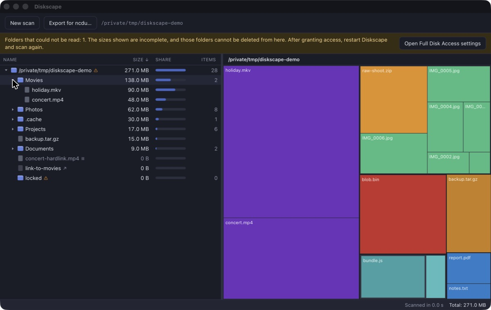

# Diskscape

A disk usage analyzer for Windows, macOS and Linux. It scans a disk or a
folder — hidden and system files included — and shows what takes up the space
as a sortable tree next to a treemap. What you find you can move to the Trash
or delete for good.



## Features

- **Sees everything.** Hidden and system files are always included. Folders
  that could not be read are marked rather than silently skipped, and the app
  offers the system's own way to grant more access.
- **Tree and map side by side.** The list shows size, share of the parent and
  item count; the treemap shows the same folder as blocks sized by disk usage
  and coloured by file type. Selecting in one selects in the other.
- **Honest sizes.** Sizes are space occupied on disk, hard links are counted
  once, symbolic links are not followed, and a scan stays on one filesystem.
- **Careful deletion.** Move to Trash, or delete permanently behind a
  confirmation. See [What Diskscape will not delete](#what-diskscape-will-not-delete).
- **Compatible with ncdu.** Opens files written by `ncdu -o` and exports files
  that `ncdu -f` reads.
- English and Russian interface, light and dark theme, following the system.

## Install

Download the installer for your system from the
[Releases](../../releases) page:

| System | File |
|---|---|
| macOS 12 or later | `.dmg` (Apple silicon and Intel) |
| Windows 10 / 11 | `.msi` or `-setup.exe` |
| Linux x86_64 | `.AppImage`, `.deb` or `.rpm` |

### The builds are not code-signed

Signing needs paid developer certificates, which this project does not have,
so the operating system will warn you the first time:

- **macOS:** open the app once, dismiss the warning, then go to
  *System Settings → Privacy & Security* and choose *Open Anyway*.
- **Windows:** in the SmartScreen dialog choose *More info → Run anyway*.

If you would rather not trust a download, build it yourself — see below.

## Use

Pick a disk on the start screen, choose a folder, or start it with a path:

```
diskscape ~/Downloads
```

| Action | How |
|---|---|
| Expand / collapse a folder | click the triangle, double-click, or → / ← |
| Select several items | Ctrl/⌘-click, Shift-click |
| Enter a folder on the map | double-click its block; the path above the map leads back |
| Show in the file manager | context menu, or double-click a file |
| Copy path | context menu, or Ctrl+C (⌘C on macOS) |
| Move to Trash | context menu, or Delete (also ⌘⌫ on macOS) |
| Delete permanently | context menu, or Shift+Delete (also ⌥⌘⌫ on macOS) — always asks first |

### Reading protected folders

Diskscape runs with ordinary rights and never asks for your password itself.
When some folders could not be read, a banner offers the system's own route:
on macOS it opens *Full Disk Access* in System Settings, on Windows it
restarts as administrator through the UAC prompt, on Linux it restarts through
`pkexec`.

### What Diskscape will not delete

A scan is a snapshot, and the disk can change afterwards. Before deleting
anything Diskscape checks that the object is still the one it scanned, and
refuses otherwise. It never deletes:

- the scanned folder itself;
- anything from a view opened from an ncdu file (those are view-only);
- a folder that is, or contains, a mount point of another filesystem;
- a folder it could not read during the scan — it looks empty but is not;
- anything whose parent folder was replaced by a link, or that was replaced
  by a different file or folder, since the scan.

If the Trash is not available for a volume, nothing is deleted; Diskscape
never falls back to permanent deletion on its own. If a permanent delete
stops part-way, it says so.

## ncdu compatibility

```
ncdu -o scan.json /some/path     # then: Open ncdu file… in Diskscape
ncdu -f diskscape-export.json    # a file exported from Diskscape
```

The JSON export format (major version 1, written by ncdu 1.x and 2.x) is
supported. The binary format (`ncdu -O`) is not.

## Known limitations

- Files that share storage — APFS clones, deduplicated or reflinked blocks —
  are each counted at full size, so totals can exceed the space really used.
- On Windows, a volume mounted into a folder is shown as a link and is not
  told apart from a junction.
- Deleting one name of a hard-linked file frees nothing until the last name
  is gone; if the other name lies outside the scanned folder, the freed
  amount shown is too high.

## Build from source

You need [Rust](https://rustup.rs), [Node.js](https://nodejs.org) 22 or later,
and the [system packages Tauri needs](https://tauri.app/start/prerequisites/).

```
npm run setup      # install the JavaScript dependencies
npm run dev        # run the app with live reload
npm test           # Rust and interface tests
npm run build      # build the installer for this system
```

The code is in three parts: `crates/core` (scanner, tree, ncdu format,
deletion, treemap layout — plain Rust, no UI), `src-tauri` (the application
shell) and `ui` (the interface, Svelte and TypeScript).

## License

[MIT](LICENSE)
